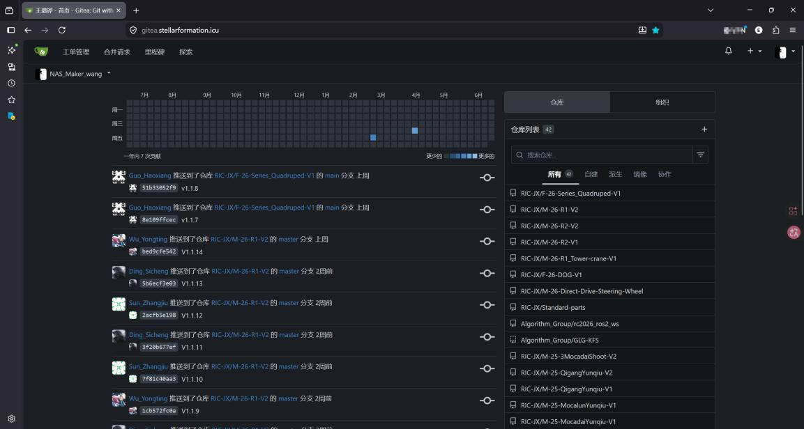
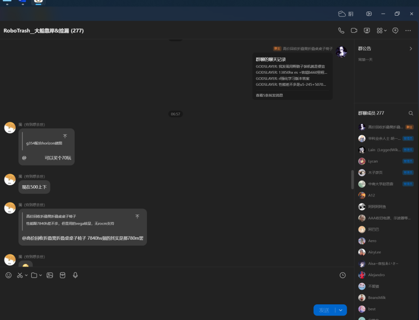

# DJI RC AWARD 2026（管理）申请材料：从跨部门协同到实验室基础设施

> **来源**：`DJI RC AWARD 2026（管理）申请材料.pdf`，2026 赛季 DJI 大疆 ROBOCON AWARD 管理方向申报书。
> **申请人**：王璟铧 · 华南理工大学 未来技术学院 人工智能专业 · 申请方向：RC AWARD（管理）—ROBOCON 战队副队长
> **博客版说明**：本文档为 2026 赛季 DJI RC AWARD 管理方向（战队副队长）申报材料的历史性存档整理。已修正个别语句；手机号已打码；原文中「管理成效综述」小节仅有模板提示语、无实质内容，已保留提示；指导老师姓名栏在原文中未填写，已如实标注。

---

## 一、基础信息

| 项目 | 内容 |
| --- | --- |
| 姓名 | 王璟铧 |
| 性别 | 男 |
| 联系方式（手机） | 139\*\*\*\*0100（原文为完整号码，公开版打码） |
| 电子邮箱 | 2455682411@qq.com |
| 最高学历 | 本科 |
| 申请方向 | RC AWARD（管理）—ROBOCON 战队副队长 |

## 二、教育经历

本科，华南理工大学，2023.09–2027.06，未来技术学院，人工智能专业（专业排名后 50%）。

## 三、RC 比赛经历

> 模板要求：请按参赛赛季从近到远填写，每段经历均需包含参赛赛季、赛项名称、比赛排名、获奖情况、比赛职位、技术方向、管理责任。

| # | 参赛赛季 | 赛项名称 | 获奖情况 | 比赛职位 | 技术方向 | 管理责任 |
| --- | --- | --- | --- | --- | --- | --- |
| 1 | 第二十五届（2026） | 武林探秘 | 二等奖 | 副队长 | 算法 | 负责全队人员信息管理及算法组内技术协调 |
| 2 | 第二十五届（2026） | 仿生足式 | 二等奖 | 副队长 | 算法 | 负责全队人员信息管理及算法组内技术协调 |
| 3 | 第二十四届（2025） | 仿生足式 | 一等奖 | 队员 | 算法 | 负责四足机器狗的 IsaacLab 强化学习 |
| 4 | 第二十四届（2025） | 飞身上篮 | 三等奖 | 队员 | 算法 | 负责 2D 雷达场地定位与 IsaacSim 舵轮仿真 |

## 四、申请材料

### 一、管理背景概述

由于 2025 赛季各部门协调出现问题，进度推进缓慢，机械组在 7 月份才将整车交付给算法与电控，导致调车时间短，未能进行充分的测试与验证，导致赛场算法精度差，无法准确投篮，进而导致比赛成绩不佳。

为解决这个问题，作为队长之一，我着手打破组织间的壁垒，让沟通更快传达，让消息准确无误快速地传达到有关负责人。注意到机械组上个赛季存在版本管理混乱导致机器人拆装出现问题，为了解决这个难题，我与算法组另一位成员共同搭建了实验室 NAS 管理系统，并且搭建了本地化的 Git 服务。同时，针对实验室内出现的散漫松懈的氛围，进行了规范与约束。因此，我根据建队以来发生的事故与矛盾制定了首版队规。与此同时，为了防止因新队规而产生的实验室氛围变得过于严肃而导致队内死气沉沉、压力过大，我与另外两位队长共同创立了华南理工大学国际校区的动漫社分部，不仅有利于实验室团建活动、增进队员友谊，也有利于实验室通过动漫社这个平台进行宣传与招新。

### 二、管理案例

> 模板要求：
> 1. 每个案例应按照 STAR（Situation, Task, Action, Result）结构化表达方式，即先讲事情背景，接着陈述任务、行动和成果。不要只描述事实现状，应提炼管理经验。
> 2. 从「目标制定与跟进」「问题分析与解决」等方向进行说明，每个方向选不超过三个典型案例进行阐述。可适当选择失败案例，分析失败原因，展示对问题的思考方式。条理清晰，切中要害，避免长篇大论。
> 3. 核心内容需是自己任职以来主要贡献的内容，突出对上一赛季管理的优化和效果。

#### 1. 目标制定与跟进

**（1）案例一：探寻 2025 赛季定位算法漂移的原因**

2025 年，我作为算法参赛队员，亲眼目睹了我们的场地定位算法的不稳定，经常会里程计定位漂移，并且导致了投篮的不准确。然而这套方案在赛前都未出现过问题，但是在赛场这个背景下定位漂移的问题却频发。为了在 2026 赛季中不再出现类似问题，我主动提出要成为解决场地定位漂移这个问题的负责人。经过频繁的测试与对比，最终确认了导致性能漂移的最大原因是**上位机 CPU 性能不足导致上位机处理点云不及时**，其次算法本身具有缺陷、存在累积误差，导致定位漂移。

**（2）案例二：实验室网络管理**

实验室网络长期以来都以校园网为主，但随着实验室设备越来越多，例如 3D 打印机、雕刻机的工控机机械图纸文件传输，都使用极为原始的 U 盘传输，下载文件速度也只有 5MB/s。此外算法组使用校园网对机器人上位机进行远控的延迟和画质不尽人意，故有必要为实验室搭建完整的内网系统。经过调研发现，3D 打印机和各种需要使用网络的设备延迟过高，是因为我们使用的路由器质量较差。我与算法组的另一位同学着手建设了实验室的配网系统：为实验室的各个房间布置了 WiFi 路由器，设置了主路由 + 旁路由，同时处理好了接线，实现了网速的带宽叠加，并将原来的配置写成文档沉淀下来。内网接入由我搭建的 NAS 后，实现了实验室的万物互联。

在搭建了网络系统之后，实验室迎来了以下变化：

1. 原先 3D 打印机无法使用的局域网打印，使用新的网络环境后可以流畅运行，并能正常使用 3D 打印机内的摄像头查看打印情况，无需亲自到场查看；
2. 算法组使用 NoMachine 调车延迟大幅下降，**延迟从 200ms 降低到 10ms**；
3. 实验室上传 / 下载速度从最高 60MB/s，提升到无线 700MB/s、有线 1000MB/s 的下载和 300MB/s 的上传速度。

#### 2. 问题分析与解决

> 针对痛点、难点问题（人员、进度、成本等），从根因分析、关键决策等角度进行阐述。

**（1）案例一：实验室版本管理，本地服务器搭建**

去年实验室出现了机械版本管理混乱、沟通出现误差的问题，算法组对车的构型没有了解乃至无法区分 R1 和 R2，因此打破沟通的壁垒成为当务之急。故我提出搭建实验室 NAS 乃至 Gitea 服务器的想法。

首先我从家里拿了一台 i3-4130 的台式机作为一代 NAS，往上插了 4 个 20 块钱的 320GB 机械硬盘组 RAID0 作为实验室的一代 NAS，后续放置了更大容量的硬盘作为服务器存储盘，总成本不超过 1000 元。当我和另一位同学搭建完成后，首先在实验室内开启试用，并且部署 Gitea 服务器。在这个过程中与机械组一同改进并优化了 Gitea 服务器和基于 Git LFS 的 SolidWorks 文件版本管理。当然 Gitea 除了给机械组用，算法组、电控组也都在这个新系统中受益。Gitea 服务器优化后内网无线传输速率超千兆，且连上校园网可用，校外只需连接华工 VPN 即可，满足了异地办公的需求。

**（2）案例二：降低算法设备成本，推进 RC 社群高性价比方案**

2025 赛季由于上位机性能不足，激光雷达的算法定位出现漂移。2026 赛季在有限的经费的情况下急需更换性能更强且具有性价比的上位机，同时购置一批可以用于实验室队员测试使用的雷达。于是在我的主导下建立了专门针对性价比选型 / 二手捡漏的社群，供队内和队外其他队伍进行选型交流，不仅促进本队节约经费，同时促进 RC 生态的队伍供应链优化。

除了群聊创建，还在实验室账号发布了性价比二手雷达方案，典型案例：

- 【[大船 TV] 大学生不到 500 元捡漏原价万元 3D 激光雷达 VLP-16，是大雷还是性价比之王？】<https://b23.tv/SZxu9Fr>

在队伍上位机选型上，最典型的案例就是 R1 搭载的 7840H 迷你主机，**仅花费 1100 元**：原文称其 CPU 性能是 Jetson Orin Nano 的 5 倍、ROCm 加速的 YOLO 推理性能是 Jetson Xavier NX 的两倍，相当于为队伍省下了 7000 元的经费。

#### 3. 管理成效综述

> 模板要求：对比本队上赛季与本赛季的整体情况，分析队伍的成长与不足，说明主要原因、采取的措施以及对队伍产生的影响。

**（原文该小节无实质内容，仅有模板提示语，待补充。）**

### 三、个人成长

#### 1. 上进心和积极性

> 从提高自身比赛热情、解决痛难点的积极性等角度进行阐述。

**（1）案例一：队规制定**

制定了实验室成立以来的第一版队规，规范队伍纪律，通过队规约束不当行为，促进实验室正循环。

**（2）案例二：创立动漫社**

在实验室的支持下创立国际校区动漫社，三位创始人皆为实验室正副队长。在实验室没有社团背靠的情况下，第一次获得了社团级别的组织背靠，同时拥有了更多团建、组织活动的机会，促进实验室队内成员身心健康发展。

#### 2. 管理意识

> 从提高自身管理意识（如抓重点做减法、系统性解决问题）等角度进行阐述。

**（1）案例一：实验室自媒体账号运营**

通过我个人运营实验室自媒体账号，并在实验室宣传运营自媒体账号的优点，带动实验室内成员积极分享技术。

**（2）案例二：减重**

由于本赛季的二代车超重严重，我们队车上的任何东西都进行了做减法的设计，细到雷达数据线，我们都从 Mid-360 线材的粗细和重量的地方开始抠重量，确保整车越来越轻，并且最终能够过检录。同时我们还阉割掉了一些不需要的功能，比如说深度相机，移除部分不必要的摄像头来进行减重，同时优化线材长度，保证电控和算法理线方便、不会干扰到机器人运动，以降低机器人整车重量。

#### 3. 沟通能力

> 从提高自身的沟通能力，从而推进组织更好协作等角度进行阐述。

**（1）案例一：针对一代车调车问题的约谈**

由于一代车出现了调车进度慢的问题，发现是因为电控组和算法组的成员在调试的过程中过于喜欢退让、不喜欢拒绝，导致双方都在互相为算法或者电控的冗余做出让步，调车效果不尽人意，调车速度也被严重拉慢。双方没有对一些不可让步的事情进行拒绝，导致不该让步的地方让步了。通过我们与算法组、电控组的调试成员进行沟通，最后实现了让算法组和电控组都拥有拒绝自己无法做到的事情的能力，同时不会割舍最关键的功能。

**（2）案例二：算法设备的安装与协调**

由于激光雷达是一个非常依赖于 FOV 视角的设备，一个更高的 FOV 能够让雷达 SLAM 算法定位更精确，同时抗退化能力更强，扫描到更多特征。因此，我们派了专门的算法组主力与机械组进行协调，协调雷达在整车上的安装位置。最终，我们在车身有限的安装位置下，协调出了很多版雷达安装方案，并且没有影响机械和算法的进度。在 RC 赛场中，我们的雷达并没有出现漂移等状况，能够获得超越 180° 的超大 FOV，确保雷达能够扫到地面特征。
