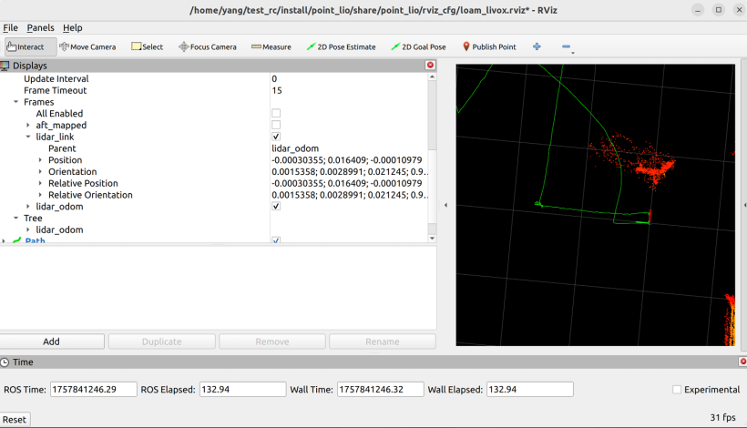
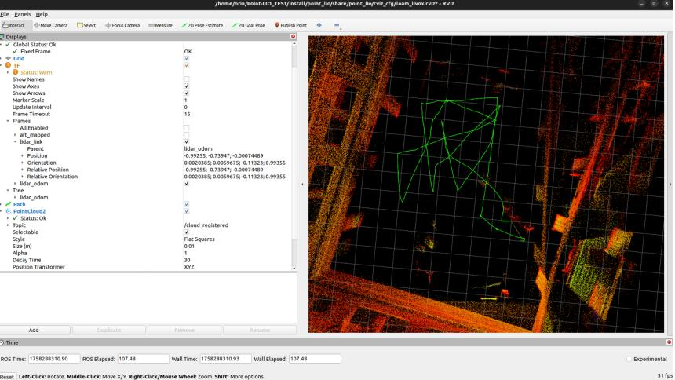
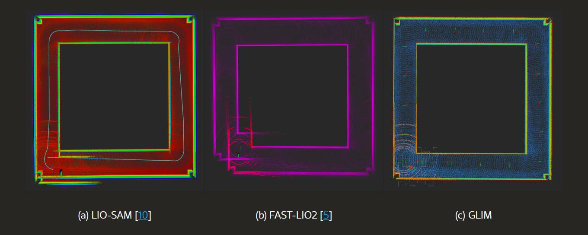
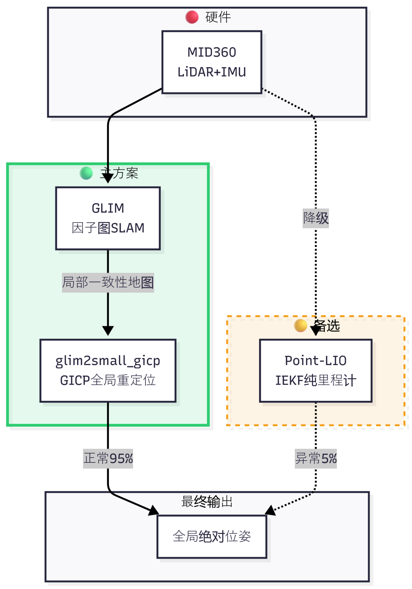
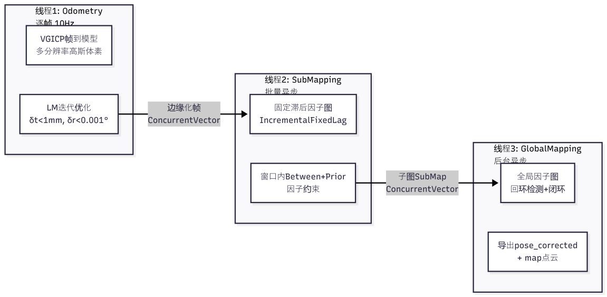
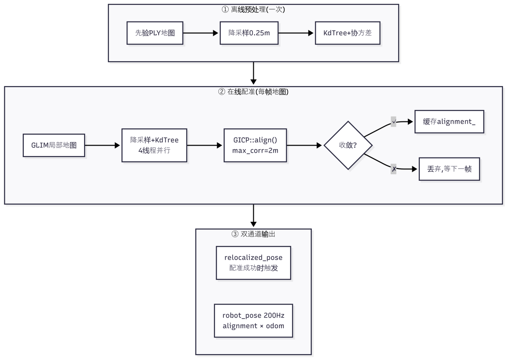

# DJI RC AWARD 2026（技术）申请材料：GLIM + Small-GICP 赛场定位方案

> **来源**：`DJI RC AWARD 2026（技术）申请材料.pdf`，2026 赛季 DJI 大疆 ROBOCON AWARD 技术方向申报书。
> **申请人**：王璟铧 · 华南理工大学 未来技术学院 人工智能专业 · 申请方向：RC AWARD（技术）—算法
> **博客版说明**：本文档为 2026 赛季 DJI RC AWARD 技术方向（算法）申报材料的历史性存档整理。已修正个别拼写（jeson→Jetson、PiontLIO→Point-LIO）与产品名称（mixG→MIX GBOX）；手机号已打码；原文中「计算消耗」小节为空白，已保留提示。按作者要求，「兴趣点」及之后的「推荐信」两节未收录。

---

## 一、基础信息

| 项目 | 内容 |
| --- | --- |
| 姓名 | 王璟铧 |
| 性别 | 男 |
| 联系方式（手机） | 139\*\*\*\*0100（原文为完整号码，公开版打码） |
| 电子邮箱 | 2455682411@qq.com |
| 最高学历 | 本科 |
| 申请方向 | RC AWARD（技术）—算法 |

## 二、教育经历

本科，华南理工大学，2023.09–2027.06，未来技术学院，人工智能专业（专业排名后 50%）。

## 三、RC 比赛经历

| # | 参赛赛季 | 赛项名称 | 获奖情况 | 比赛职位 | 技术方向 | 责任内容 |
| --- | --- | --- | --- | --- | --- | --- |
| 1 | 第二十五届（2026） | 武林探秘 | 二等奖 | 副队长 | 算法 | 负责 R1、R2 场地里程计定位与重定位 |
| 2 | 第二十五届（2026） | 仿生足式 | —（材料提交截止日期比赛成绩未出，故无排名与奖项） | 副队长 | 算法 | 负责四足机器狗的导航与感知 |
| 3 | 第二十四届（2025） | 仿生足式 | 一等奖 | 队员 | 算法 | 负责四足机器狗的 IsaacLab 强化学习 |
| 4 | 第二十四届（2025） | 飞身上篮 | 三等奖 | 队员 | 算法 | 负责 2D 雷达场地定位与 IsaacSim 舵轮仿真 |

## 四、技术背景概述

2025 年，我作为算法参赛队员，亲眼目睹了我们的场地定位算法的不稳定，经常会里程计定位漂移，并且导致了投篮的不准确。当时定位方案如下：

- **上位机**：Nvidia Jetson Orin Nano
- **激光雷达**：Livox Mid-360
- **里程计定位算法**：Point-LIO
- **重定位算法**：ICP

然而这一套方案在赛前都未出现过问题，但是在赛场这个背景下定位漂移的问题却频发。为了在 2026 赛季中不再出现类似问题，我主动提出要成为解决场地定位漂移这个问题的负责人，于是我本人负责了 2026 赛季的全部场地定位算法。

经过频繁的测试与对比，最终确认了导致性能漂移的最大原因是**上位机 CPU 性能不足导致上位机处理点云不及时，出现定位漂移**；且上位机使用的 Point-LIO 算法是一个基于 CPU 处理点云的算法，无法利用 GPU 进行加速，而点云本身的性质就意味着点云处理可以转化为体素并进行 GPU 加速，从而降低 CPU 负载，实现资源分配的最优化。在此背景下，我们测试了若干开源算法，最终找到符合我们要求的算法，即 **GLIM 算法**（*3D Range-Inertial Localization and Mapping with GPU-Accelerated Scan Matching Factors*）。

## 五、技术详细方案

**Situation**：由于去年场地定位出现了性能不足的情况，因此我们上位机采用了更高性能的 x86 设备。

### 算法整体方案

| 模块 | R1 机器人 | R2 机器人 |
| --- | --- | --- |
| 上位机 | R7-7840H 迷你主机 | 雷神 MIX GBOX（i7-13620H + RTX 4060） |
| 激光雷达 | Livox Mid-360 | Livox Mid-360 |
| 里程计定位算法 | GLIM（CPU 版） | GLIM（CUDA 版） |
| 重定位算法 | Small-GICP | Small-GICP |

### 5.1 算法（感知）

#### 1. 技术方案调研和对比

**上位机方案调研**：

经过测试，在运行同一个使用 Mid-360 录制的 rosbag 的 Point-LIO 算法时，Jetson Orin Nano 测试了三次均出现了较大幅度的漂移，且录制 rosbag 时起点与终点都为原点；而使用 R5-5600X 这款 CPU 运行 Fast-LIO 无异常漂移，更接近原点。因此判定 Orin Nano 已无法应付激光雷达 SLAM 算法，故需要更换性能更强的上位机用来进行场地定位。

| Jetson Orin Nano 运行情况 | R5-5600X 运行情况 |
| :---: | :---: |
|  |  |

最终我们决定更换上位机方案，弃用 Jetson Orin Nano，改用性能更强劲且线程数不少于 12 线程的迷你主机方案。考虑到 RC 比赛对整车功耗的要求不高，利远大于弊。

**算法项目方案调研**：Fast-LIO、Point-LIO、Faster-LIO、Fast-LIO2。

对比结果：

#### 2. 算法架构设计

**一、整体架构：主备双层设计**

**二、为什么这样设计？**

系统定位采用主备双层架构，源于四项约束：

1. 场地先验地图已知，故以 GICP 将实时点云与全局地图配准，获取绝对位姿；
2. 任务需绝对坐标，配准结果直接输出场地坐标系位姿；
3. 里程计长时漂移，以 GLIM 因子图回环优化消除累积误差；
4. 系统不可因单点故障崩溃，保留 Point-LIO 纯里程计作为兜底。

整体遵循 **“全局为主、局部为辅、异步解耦、故障降级”** 的设计原则。

**三、主方案：GLIM + GICP 详细架构**

##### 3.1 GLIM 三层异步流水线

GLIM 将 SLAM 过程拆分为三个独立线程，通过线程安全的 ConcurrentVector 无锁队列进行数据传递，实现计算解耦。

- **第一层：Odometry Estimation（前端里程计）**。逐帧运行于 10Hz，对每帧激光点云执行 VGICP（Voxelized GICP）帧到多分辨率高斯体素地图的配准，利用 Levenberg-Marquardt 优化器迭代求解相邻帧间的相对位姿变换，收敛条件为平移变化小于 1 毫米且旋转变化小于 0.001 度。优化完成后输出 EstimationFrame（包含位姿估计、IMU 预积分因子和 BetweenFactor 约束），同时将旧帧边缘化后传递给下一层。
- **第二层：SubMapping（局部子图构建）**。异步接收前端边缘化的帧数据，在局部滑动窗口内构建因子图，使用 IncrementalFixedLagSmoother（增量固定滞后平滑器）对窗口内的位姿节点进行批量优化。窗口内每一对相邻帧之间施加 BetweenFactor 相对位姿约束和 PriorFactor 先验约束，抑制局部噪声，输出内部一致的 SubMap 子图。
- **第三层：GlobalMapping（全局建图与优化）**。异步接收子图，在全局尺度上维护完整因子图。当检测到回环时，将闭合约束加入因子图并触发全局非线性优化，消除长期累积漂移。最终输出经过全局校正的位姿 `/pose_corrected` 和全局一致的点云地图 `/glim_ros/map`。

三层异步设计的核心意图是：**前端配准不能等待后端优化完成，全局回环求解不能阻塞实时里程计输出**。三者通过无锁队列解耦，互不干扰，保证了系统的实时性。

##### 3.2 GICP 重定位流程

重定位分为离线预处理和在线配准两个阶段，配合双通道输出机制实现高频全局位姿输出。

- **离线预处理**：系统启动时加载赛前高精度扫描得到的 PLY 格式先验全局地图，使用 small_gicp 库对其进行体素降采样（分辨率 0.25 米）、KdTree 构建和点协方差估计，预处理结果常驻内存，后续配准直接复用。
- **在线配准**：每当 GLIM 的 GlobalMapping 层输出新的局部一致性点云地图时触发。首先对局部地图执行同等参数的降采样和 KdTree 构建（4 线程并行），然后调用 `small_gicp::align()` 执行 GICP 配准，最大对应点距离设为 2 米。GICP 将每个点视为高斯分布，在概率框架下最小化马氏距离来求解目标地图到源地图的最优刚体变换。若配准收敛，将得到的对齐变换矩阵缓存；若发散则丢弃本次结果等待下一帧。

##### 3.3 双输出通道设计思路

GICP 配准单次耗时约 200 毫秒，但系统需要 200Hz 高频位姿。解决方案是**配准成功后缓存对齐变换，后续每个高频里程计位姿到达时仅需做一次矩阵乘法**：

$$\text{全局位姿} = \text{缓存对齐变换} \times \text{实时里程计位姿}$$

即可获得全局绝对位姿，无需重复跑完整配准流程。两个输出通道分别为：

- **重定位位姿**：仅配准成功时触发；
- **连续位姿**：每个里程计帧均输出（200Hz）。

两次配准之间，用缓存的对齐变换乘实时里程计，无需重复配准。

#### 3. 功能和性能指标的定义

- **定位精度**：指的是在 RC2026 场地（半场 / 全场）上运动若干时间后回到原点以及走到定点，将定位坐标位姿数据与实际的物理距离进行比较。
- **计算消耗**：（原文该小节为空白，未填写数据，待补充。）

#### 4. 算法实现逻辑

**一、传感器输入**

`livox_ros_driver2` 驱动 Mid-360 雷达，发布 `/livox/lidar`（点云 10Hz）和 `/livox/imu`（IMU 200Hz），Point-LIO 和 GLIM 同时订阅。

**二、Point-LIO：IEKF 紧耦合里程计（备选）**

- **预测（200Hz）**：IMU 数据驱动状态传播——位置由速度积分，姿态由去偏置角速度更新，速度由旋转后的加速度加重力更新。协方差同步传播。
- **更新（10Hz）**：收到点云帧后，用 IMU 位姿序列去畸变；每个点通过 iVox 搜索 5 近邻拟合平面，计算点到平面距离作为残差，构建雅可比矩阵，IEKF 迭代更新状态并增量插入体素地图。

核心公式：残差

$$z = n_x p_x + n_y p_y + n_z p_z + d$$

雅可比

$$H = [\, n,\; [p]_\times R^T n,\; 0 \,]$$

**三、GLIM：因子图 SLAM（主方案前端）**

- **第一层 Odometry（10Hz 逐帧）**：VGICP 将当前帧配准到多分辨率高斯体素地图，LM 优化收敛（平移 < 1mm，旋转 < 0.001°），输出 BetweenFactor 和边缘化帧。
- **第二层 SubMapping（异步）**：局部窗口内因子图用 IncrementalFixedLagSmoother 平滑，生成一致性 SubMap。
- **第三层 GlobalMapping（异步）**：全局因子图 + 回环检测闭环求解，输出校正位姿 `/pose_corrected` 和局部地图 `/glim_ros/map`。三层通过 ConcurrentVector 无锁队列通信，前端不等待后端。

**四、GICP 全局重定位（主方案后端）**

- **离线**：加载先验 PLY 地图，降采样 0.25m + KdTree + 协方差估计。
- **在线**：GLIM 局部地图到达时，同样降采样后调用 `small_gicp::align()` 配准。GICP 将点建模为高斯分布，最小化

$$\min_T \sum r^T \left( \Sigma_{tgt} + T \, \Sigma_{src} \, T^T \right)^{-1} r$$

  收敛后缓存对齐变换。
- **双通道输出**：缓存 alignment 后，每个高频里程计帧仅做 $pose = alignment \times odom$ 即得全局位姿（200Hz），无需重复配准。

## 六、参考资料

1. Kenji Koide, Masashi Yokozuka, Shuji Oishi, Atsuhiko Banno. *GLIM: 3D Range-Inertial Localization and Mapping with GPU-Accelerated Scan Matching Factors*. Robotics and Autonomous Systems, 2024, Vol. 179, 104750.
2. Kenji Koide, Masashi Yokozuka, Shuji Oishi, Atsuhiko Banno. *Voxelized GICP for Fast and Accurate 3D Point Cloud Registration*. ICRA 2021.
3. （博客版补充）Kenji Koide. *small_gicp: Efficient and parallel algorithms for point cloud registration*. Journal of Open Source Software, 2024, 9(100): 6948. doi:10.21105/joss.06948.
